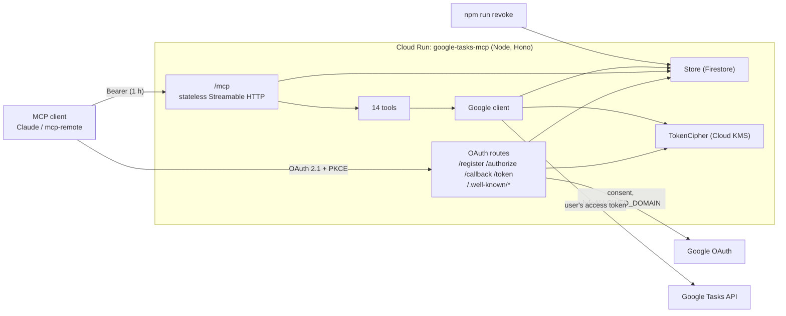

# GCP deployment of google-tasks-mcp — design

* **Status**: Draft for review, 2026.W42 (2026-10-17)
* **Authors**: YC Lian, Claude (Opus 5.5)
* **Repo**: `github.com/yclian/google-tasks-mcp` (fork of `akutishevsky/google-tasks-mcp`)
* **Related**: `docs/adr/adr-001-central-encrypted-token-store.md` (to be written)

## 1. Goal

One shared Google Tasks MCP server for the users of a Google Workspace domain, on
Cloud Run in `<project>` at `https://<host>`, usable from Claude (web, Desktop,
Code) and `mcp-remote` clients. Each user signs in with their own `@<domain>`
Google account and reaches only their own tasks.

The fork stays **upstream-compatible**: every change is additive, and with no new
configuration the server behaves as upstream does today on Deno Deploy. A
personal single-user instance runs from the same code with default settings.

### Public repo, private values

This spec, the code and `infra/` are public and generic. Values specific to one
deployment (project id, region, domain, hostname, Terraform state bucket, KMS key
path) are written here as placeholders (`<project>`, `<region>`, `<domain>`,
`<host>`) and supplied at deploy time through an untracked `terraform.tfvars`,
`terraform init -backend-config=…` and environment variables. The deployer keeps
those values, and any organisation-specific runbook, outside this repo.

### Success criteria

| # | Criterion |
|---|-----------|
| AC1 | Several users connect concurrently; each tool call reaches Google with that user's own credentials. |
| AC2 | A user stays connected across restarts, deploys and scale-to-zero. |
| AC3 | With `ALLOWED_DOMAIN` set, only accounts in that Workspace domain can complete login. |
| AC4 | No re-login for 30 days of normal use; access-token expiry is invisible to the user. |
| AC5 | An admin can revoke one user, or everyone, with one command. |
| AC6 | A leak of the Firestore data alone exposes no usable credential. |
| AC7 | With none of the new settings, behaviour matches upstream (Deno KV, `ENCRYPTION_SECRET`, open to any Google account). |
| AC8 | The deployed service connects from Claude web, Claude Code and `mcp-remote`. |

## 2. Findings that drive the design

* **Deno KV is in memory on Node.** `@deno/kv`'s `openKv()` with no path uses the
  native `Deno.openKv` under Deno, but falls back to an **in-memory** store under
  Node (`node_modules/@deno/kv/esm/npm.js:31-42`). Upstream calls `openKv()` with no
  path in three places, so persistence only works on Deno Deploy.
* **No Node server entrypoint.** `src/index.ts` exports `{ fetch }` for Deno Deploy;
  `@hono/node-server` is a dependency but unused.
* **Hand-written SSE transport.** `HonoSSETransport` returns one SSE message per POST
  with no session id and a 30s backstop; `GET /mcp` streams heartbeats only. The SDK
  (1.27 installed, 1.32 latest) ships `WebStandardStreamableHTTPServerTransport`,
  which works directly with Hono (`transport.handleRequest(c.req.raw)`).
* **Refresh grant advertised but rejected.** AS metadata lists `refresh_token`
  (`src/server/app.ts:92`); `/token` accepts only `authorization_code`. Users must
  re-authorize when the 30-day token lapses.
* **`/authorize` trusts any `redirect_uri`.** `/register` stores whatever redirect
  URIs it gets, and `/authorize` never checks `client_id` or `redirect_uri` against
  the registration.
* **No protected-resource metadata.** No `/.well-known/oauth-protected-resource`;
  current Claude clients treat that as a "server configuration issue".
* **Raw bearer tokens are store keys.** `["tokens", mcpToken]` — anyone who can read
  the store can use the keys as bearer tokens.
* **Key derivation per call.** `encrypt`/`decrypt` run PBKDF2 (100k iterations) on
  every call.
* **Rate limiter trusts the first `X-Forwarded-For` value**, which the client controls.
* **Landing and privacy pages carry upstream's branding and Google Analytics tag.**

## 3. Decisions

| Area | Decision | Rejected, and why |
|------|----------|-------------------|
| Token model | **Central encrypted store** (upstream's model, hardened). Clients hold only opaque tokens for our server; Google tokens never leave our infrastructure. Recorded in ADR-001. | *Pass-through Google tokens* (clients hold Google's tokens directly): no central kill switch; Google refresh tokens land on client devices (`mcp-remote` stores them in plaintext); a compromised client can call Google directly; large divergence from upstream. |
| Rule for future MCPs | Identity-only scopes (`openid email`) → pass-through. Scopes that reach user data (Tasks, Drive, …) → central encrypted store. | — |
| Storage | `Store` interface; `STORAGE=denokv` (default, with optional `KV_PATH`) or `STORAGE=firestore`. | Remote Deno KV from GCP: user tokens held by an external vendor. |
| Encryption | `TokenCipher` interface; `CIPHER=static` (default, `ENCRYPTION_SECRET`) or `CIPHER=gcpkms` (Cloud KMS encrypts each token directly). | Envelope encryption: more code for no gain at this token size. |
| Token lifetimes | Our access token 1 h; our refresh token 30 d, rotated on every use, reuse detected. | One 30-day token: a leaked bearer is useful for a month. |
| Identity | Request `openid email` alongside `tasks`; store the email with each grant. `ALLOWED_DOMAIN` adds Google's `hd` hint and checks `hd` + `email_verified` on the `id_token`. | — |
| Kill switch | `npm run revoke -- --email <addr>` / `--all`, run with an admin's gcloud credentials, plus a runbook entry. | Admin MCP tool: privileged tool on the public endpoint. Console by hand: not auditable. |
| Transport | SDK `WebStandardStreamableHTTPServerTransport`, **stateless** (`sessionIdGenerator: undefined`), `enableJsonResponse: true`. | Stateful sessions: needs one instance or sticky routing, and breaks on Deno Deploy isolates. |
| Runtime | New Node entrypoint (`@hono/node-server`), Node 20+ container. | `deno serve`: one more runtime to operate on GCP, where Node is the common choice. |
| Exposure | Public HTTPS, `allUsers` invoker; `/mcp` gated by OAuth + domain. | Cloudflare ZTNA: Claude's remote connectors cannot complete an Access login or send service-token headers. Static API token: loses user identity; still needs per-user Google OAuth. |
| Hostname | Custom `<host>` from day one via Cloud Run domain mapping + a DNS CNAME. Fall back to `run.app` only if domain verification blocks. | Start on `run.app`: issuer and redirect URI are baked into every connector; migrating forces reconnects. |
| Consent screen | OAuth consent screen **Internal** in `<project>`. | External: requires Google verification for the sensitive `tasks` scope. |
| Deploy | Manual `gcloud` runbook in `DEPLOY.md`; CI is left to each deployer. | A bundled CI pipeline: ties the fork to one CI vendor. |
| Landing page | `PUBLIC_PAGES=false` serves a plain JSON `/` and drops the analytics CSP. Default `true` (upstream). | Serving upstream's branded page with its analytics on another organisation's domain. |

## 4. Architecture



Every request is self-contained: the Store holds all state, so any instance can
serve any request and scale-to-zero is safe.

## 5. Components

Each unit has one job and is reached only through its interface.

### 5.1 `Store` (`src/store/`)

```ts
interface Store {
  get<T>(key: string[]): Promise<T | null>;            // null when absent or expired
  set<T>(key: string[], value: T, opts?: { ttlMs?: number }): Promise<void>;
  delete(key: string[]): Promise<void>;
  take<T>(key: string[]): Promise<T | null>;           // atomic get + delete; one winner
  list<T>(prefix: string[]): Promise<Array<{ key: string[]; value: T }>>;
}
```

* Values are wrapped as `{ v, expiresAt }`. Implementations check `expiresAt`
  against an injected clock on read, so expiry semantics are identical across
  backends and testable; backend TTL (Deno KV `expireIn`, Firestore TTL policy) is
  garbage collection only. Firestore TTL deletion can lag by up to a day, which is
  why reads must check.
* `DenoKvStore(path?)` wraps `@deno/kv`. `KV_PATH` unset keeps upstream behaviour.
* `FirestoreStore(db)` maps `key[0]` to a collection and the rest to an encoded doc
  id; `take` runs in a transaction; strips `undefined` fields before writes.
  `@google-cloud/firestore` is imported lazily, only when selected.
* Consumers: token store, OAuth store (sessions, codes, clients), rate limiter.

### 5.2 `TokenCipher` (`src/crypto/`)

```ts
interface TokenCipher {
  encrypt(plaintext: string): Promise<string>;
  decrypt(ciphertext: string): Promise<string>;   // throws on tamper or wrong key
}
```

* `StaticCipher` is upstream's AES-256-GCM scheme, with the PBKDF2 key derived once
  per process. The on-disk format is unchanged, so existing upstream data still
  decrypts.
* `KmsCipher(kmsClient, keyName)` calls Cloud KMS `encrypt`/`decrypt` per token
  (well under the 64 KiB limit). The KMS client is injected (the seam for tests).
  `@google-cloud/kms` is imported lazily.
* Decrypted Google access tokens are cached in memory per grant until
  `min(5 min, Google expiry − 60 s)`, so a hot path makes no KMS call.

### 5.3 Token model (`src/auth/token-store.ts`)

All bearer and refresh values are random 256-bit strings. Store keys use their
SHA-256 hash, never the raw value.

| Key | Value | TTL |
|-----|-------|-----|
| `grants/{grantId}` | `email`, `clientId`, `encGoogleAccess`, `encGoogleRefresh`, `googleExpiresAt`, `createdAt` | 30 d, extended on refresh |
| `access/{sha256(at)}` | `grantId` | 1 h |
| `refresh/{sha256(rt)}` | `grantId`, `usedAt?` | 30 d |
| `grants_by_email/{email}/{grantId}` | `{}` | 30 d, extended with the grant |

* **Refresh rotation.** `/token` with `grant_type=refresh_token` atomically marks the
  presented refresh record used, then issues a new access + refresh pair for the same
  grant. The request's `client_id` must match the grant's, else `invalid_grant`.
* **Reuse detection.** A refresh token presented after it was used:
  * within a **60 s grace window** → `invalid_grant`, grant kept (covers two client
    tabs refreshing at once);
  * after the window → `invalid_grant` and the **whole grant is revoked**.
* **Google refresh.** On a tool call, if `googleExpiresAt − 60 s` has passed, the
  server refreshes with Google and re-encrypts. Google `invalid_grant` (user removed
  the app, account suspended) deletes the grant, and the client gets 401.
* **Revoke.** Deleting the grant makes every access and refresh record for it dead
  (lookups resolve to a missing grant). The revoke command also calls Google's
  revoke endpoint for the Google refresh token.

### 5.4 OAuth routes (`src/auth/oauth.ts`)

Changes on top of upstream:

* `/authorize` rejects an unknown `client_id`, or a `redirect_uri` not in that
  client's registration, with **400 and no redirect**.
* Scope requested from Google: `openid email https://www.googleapis.com/auth/tasks`;
  `hd` added when `ALLOWED_DOMAIN` is set.
* `/callback` reads the `id_token` from Google's token response (received directly
  over TLS, so its claims are trusted without signature verification, per Google's
  guidance). With `ALLOWED_DOMAIN` set it requires `hd === ALLOWED_DOMAIN` and
  `email_verified`, else **403 text/plain** with a generic message, nothing stored.
  Error query parameters are never echoed.
* `/token` implements `refresh_token` (5.3). Responses carry `expires_in: 3600` and a
  `refresh_token`.
* `/.well-known/oauth-protected-resource` and `/.well-known/oauth-protected-resource/mcp`
  both serve the same document (`resource = <ISSUER_URL>/mcp`).
* 401s from `/mcp` carry `WWW-Authenticate: Bearer resource_metadata="…"`.
* `ISSUER_URL` (optional) pins the issuer; unset keeps upstream's request-origin
  behaviour.

### 5.5 Transport (`src/server/mcp-endpoints.ts`)

`POST /mcp`: authenticate, build a per-request `McpServer` with the 14 tools bound
to the grant, connect a stateless `WebStandardStreamableHTTPServerTransport` with
`enableJsonResponse: true`, return `transport.handleRequest(c.req.raw)`.
`GET`/`DELETE /mcp` get the SDK's stateless responses. `HonoSSETransport` and
`SessionManager` are deleted.

### 5.6 Google client (`src/google/api.ts`)

Takes `{ getAccessToken(): Promise<string>, fetch }` instead of an MCP token. The 14
API functions and their URLs are unchanged. `fetch` is the seam where tests replay
recorded Google responses.

### 5.7 Entrypoints

* `src/index.ts` keeps the Deno Deploy `export default { fetch }`.
* `src/node.ts` builds the same app from config and serves it with `@hono/node-server`
  on `PORT`.
* `src/config.ts` reads all env vars once and builds Store and TokenCipher; nothing
  else reads `process.env`.

### 5.8 Rate limiter

Uses the Store. With `TRUST_PROXY_HOPS=n`, the client IP is the n-th entry from the
right of `X-Forwarded-For` (Cloud Run: 1). Unset keeps upstream's behaviour.

### 5.9 Revoke command (`scripts/revoke.ts`)

`npm run revoke -- --email <addr>` / `--all` / `--dry-run`. Builds the same Store
and TokenCipher from env, lists grants by email (or all), calls Google revoke,
deletes the grants, and prints a count. It needs `roles/datastore.user` and KMS
decrypt.

## 6. Configuration

| Env var | Default (upstream) | GCP option |
|---------|--------------------|---------------|
| `GOOGLE_CLIENT_ID` / `GOOGLE_CLIENT_SECRET` | required | Secret Manager |
| `GOOGLE_REDIRECT_URI` | `http://localhost:3000/callback` | `https://<host>/callback` |
| `ISSUER_URL` | request origin | `https://<host>` |
| `STORAGE` | `denokv` | `firestore` |
| `KV_PATH` | unset (in memory on Node) | — |
| `FIRESTORE_DATABASE` | — | `google-tasks-mcp` |
| `CIPHER` | `static` | `gcpkms` |
| `ENCRYPTION_SECRET` | required for `static` | — |
| `KMS_KEY_NAME` | — | `projects/<project>/locations/<region>/keyRings/google-tasks-mcp/cryptoKeys/token-encryption` |
| `ALLOWED_DOMAIN` | unset (any account) | `<domain>` |
| `TRUST_PROXY_HOPS` | unset | `1` |
| `PUBLIC_PAGES` | `true` | `false` |
| `PORT`, `LOG_LEVEL`, `ALLOWED_ORIGINS` | as upstream | `8080`, `info`, unset |

Startup fails fast on an invalid combination (e.g. `CIPHER=gcpkms` without
`KMS_KEY_NAME`).

## 7. Error handling

| Situation | Response |
|-----------|----------|
| Missing/expired/unknown bearer | 401 + `WWW-Authenticate` with `resource_metadata` |
| Grant deleted, or Google `invalid_grant` | 401 (client re-authorizes) |
| Google API 4xx/5xx in a tool | Tool result `isError: true` with status and Google's message; never a 500 |
| Invalid tool arguments | SDK validation error |
| KMS or Firestore unavailable | 503 with generic body; logged with component tag |
| Domain mismatch at callback | 403 `text/plain`, generic message |
| Unknown client or redirect at `/authorize` | 400 JSON, no redirect |

The logger's existing redaction stays, and is extended to our bearer/refresh values.

## 8. Infrastructure (`infra/`)

Terraform, Google provider, GCS state backend. `project`, `region`, `domain` and
`host` are variables with no committed values; the backend bucket is passed with
`terraform init -backend-config=backend.hcl`. `.gitignore` excludes `*.tfvars`
(except `terraform.tfvars.example`) and `backend.hcl`.

| Resource | Notes |
|----------|-------|
| Artifact Registry `google-tasks-mcp-repo` | Docker |
| Service account `gtasks-mcp-sa` | runtime |
| Firestore Native database `google-tasks-mcp` | TTL policy on `expiresAt` for each collection |
| KMS key ring `google-tasks-mcp`, key `token-encryption` | 90-day rotation; SA gets `cryptoKeyEncrypterDecrypter` on this key only |
| Secret Manager `gtasks-mcp-google-client-id` / `-secret` | SA gets accessor on each |
| Cloud Run v2 service `google-tasks-mcp` | env from §6; min 0, max 3; image ignored in lifecycle (deployed out of band) |
| `run.invoker` for `allUsers` | server enforces OAuth |
| Domain mapping `<host>` | behind `enable_custom_domain`; outputs the DNS records to create |
| Deployer SA `gtasks-mcp-deployer` | AR writer, Run developer, SA user (for whatever CI the deployer adds) |
| APIs | run, artifactregistry, firestore, cloudkms, secretmanager, tasks |

Manual one-offs, recorded in `DEPLOY.md`: OAuth consent screen (Internal), OAuth
client (web, redirect `<ISSUER_URL>/callback`), secret versions, Search Console
domain verification, DNS CNAME.

## 9. Deploy and operate

* `DEPLOY.md`: first-time setup, then build, push and `gcloud run deploy` with a
  commit-SHA tag, and the no-browser OAuth checks (curl the well-known documents,
  expect 401 + `resource_metadata` on `POST /mcp`).
* `MAINTAIN.md`: endpoints, config table, revoke runbook, connector gotchas, how to
  rotate the KMS key (automatic) and the Google client secret.
* Connector set-up note for users: add `https://<host>/mcp` as a custom connector.

## 10. Upstream strategy

1. Open an issue on `akutishevsky/google-tasks-mcp` describing the fixes and the
   optional storage/cipher backends; ask before sending the larger PRs.
2. Build the fork's commits in an order that cherry-picks cleanly. Each upstream PR
   branch is cut from `upstream/main`.

| PR | Contents | Upstream? |
|----|----------|-----------|
| 1 | Node entrypoint + config module | yes |
| 2 | SDK stateless Streamable HTTP transport | yes |
| 3 | `/authorize` client and redirect validation; protected-resource metadata | yes |
| 4 | Hashed token keys, refresh grant with rotation, 1 h access tokens | yes |
| 5 | `Store` interface + `KV_PATH` | yes |
| 6 | `TokenCipher` interface + key derived once | yes |
| 7 | `ALLOWED_DOMAIN`, `openid email`, `TRUST_PROXY_HOPS`, `PUBLIC_PAGES` | yes |
| 8 | Test suite (vitest, fixtures, scenario suites) | offered |
| 9 | "gcloud option": `FirestoreStore` + `KmsCipher` | offered; fork-only if declined |
| — | `infra/`, Dockerfile, `DEPLOY.md`, `MAINTAIN.md`, ADR, this spec | fork only |

Declined PRs cost nothing: the fork carries every change.

## 11. Testing

Scenario-and-oracle testing: every test names its fixture, the oracle that says
what is correct, and its assertions. Oracle rank (1 is strongest): 1 planted truth,
2 independent recomputation or model, 3 legacy parity, 4 specification, 5 published
test vector. Runner: **vitest**, properties with **fast-check**.
Nothing under `src/` is mocked. Google and KMS are third-party network edges: Google
is replayed from recorded fixtures through the `fetch` seam; KMS uses a faithful fake
client (encrypt/decrypt with tamper detection). Time is injected through a clock
seam; randomness is seeded where it reaches an assertion.

### 11.1 Phase 0: characterisation

Before any refactor, run upstream's code against the recorded Google fixtures and
save every tool's output and the OAuth route responses as goldens under
`test/characterisation/`, **labelled as characterisation, not certification**. Each
golden is deleted when the scenario below that certifies the same behaviour lands.

### 11.2 Fixtures

`scripts/record-fixtures.ts` runs once against a real test account and writes
`test/fixtures/google/<endpoint>.{ok,err}.json`: one success and one failure (404 or
400) for each of the 14 Tasks endpoints, plus Google token exchange, token refresh
(ok and `invalid_grant`) and revoke. Tokens and emails are replaced with planted
values before saving.

### 11.3 Nature of each part

| Nature | Parts | Boundary |
|--------|-------|----------|
| Boundary handler | OAuth routes, `/mcp` + tools, revoke command | `app.fetch(new Request(…))`, the same entry a client reaches; the command's main function |
| Stateful store access | `DenoKvStore`, `FirestoreStore`, token model | `Store` API, one suite across backends |
| Pure transform | PKCE, `StaticCipher`, Firestore key encoding, `addReadableTimestamps`, `X-Forwarded-For` parsing | function signature |

### 11.4 Scenario table — OAuth and transport

| Scenario | Fixture / generator | Oracle | Assertions |
|----------|---------------------|--------|------------|
| `discovery_documents` | none | MCP auth spec (rank 4) | AS metadata has S256, `registration_endpoint`, `refresh_token`; PRM served at origin and `/mcp` path with `resource = ISSUER/mcp` |
| `mcp_without_bearer` | none | spec | 401 with `resource_metadata` |
| `full_login` | planted user A; recorded Google token exchange | recorded reality + spec | register → authorize 302 to Google with `openid email tasks`, `access_type=offline` → callback 302 to client with code + original state → token (PKCE) gives `expires_in 3600` + refresh token → `tools/list` returns 14 tools |
| `pkce_mismatch` | planted verifier | spec | `invalid_grant`; no tokens issued |
| `unregistered_redirect_uri` | client registered with URI X, authorize with Y | spec | 400, no `Location` header |
| `unknown_client_id` | none | spec | 400, no redirect |
| `auth_code_replay` | completed login | spec | second exchange `invalid_grant` |
| `wrong_domain` | `ALLOWED_DOMAIN=example.com`, id_token `hd=gmail.com` | planted truth (rank 1) | 403 text/plain; no grant stored; `hd` present on the Google redirect |
| `unverified_email` | id_token `email_verified=false` | planted truth | 403 |
| `domain_unset_open` | no `ALLOWED_DOMAIN`, gmail id_token | upstream behaviour | login succeeds; no `hd` on redirect |
| `refresh_rotation` | completed login | spec | new pair; new access works |
| `refresh_wrong_client` | refresh token from client A presented by client B | design 5.3 | `invalid_grant`; grant still valid for A |
| `refresh_reuse_in_grace` | same refresh token twice within 60 s (clock) | design 5.3 | second `invalid_grant`; grant still valid |
| `refresh_reuse_after_grace` | reuse after 61 s | design 5.3 | `invalid_grant`; grant revoked; latest access token now 401 |
| `access_token_expiry` | clock +61 min | spec | 401; refresh then succeeds |
| `google_token_refresh_on_call` | `googleExpiresAt` in the past; recorded refresh ok | recorded reality | tool succeeds; the fake saw the refreshed token on the Tasks call |
| `google_invalid_grant` | recorded refresh `invalid_grant` | recorded reality | 401; grant deleted |
| `stateless_across_instances` | two app instances, one store | design 5.5 | `initialize` on one and `tools/call` on the other both succeed; JSON content type; no session header required |
| `notification_accepted` | `notifications/initialized` | SDK contract | 202, empty body |
| `register_rate_limit` | 31 registrations in an hour; spoofed leading XFF; `TRUST_PROXY_HOPS=1` | planted truth | 31st is 429 despite a changing spoofed value |
| `revoke_one_user` | planted users A and B | planted truth | after `--email A`: A's tokens 401, B's tools still work, Google revoke called once for A |
| `revoke_all` | planted users A, B, C | planted truth | all 401; revoke called three times; count printed is 3 |

### 11.5 Scenario table — tools

| Scenario | Fixture | Oracle | Assertions |
|----------|---------|--------|------------|
| `<tool>_ok` × 14 | `<endpoint>.ok.json` | recorded reality; readable timestamps recomputed independently in the test (rank 2) | Google called with the documented method, path and query; result JSON equals the recorded body plus the `*_readable` fields |
| `<tool>_google_error` × 14 | `<endpoint>.err.json` | recorded reality | `isError: true`, status and Google message present, HTTP 200 |
| `tool_invalid_args` | missing required field | SDK contract | validation error, Google not called |
| `two_users_isolated` | planted users A, B with distinct Google tokens | planted truth (rank 1) | each user's calls carry only that user's Google token |

### 11.6 Store suite (every backend)

Backends: `DenoKvStore` in memory, `DenoKvStore` with a temp `KV_PATH`, and
`FirestoreStore` against the Firestore emulator. The emulator tier needs Java and
the gcloud emulator; when it is unavailable the run says so explicitly rather than
skipping silently.

| Scenario | Oracle | Assertions |
|----------|--------|------------|
| `read_after_write`, `delete_then_read` | read-after-write truth | as named |
| `expired_entry_invisible` | injected clock | `get`, `take`, `list` never return an entry past `expiresAt` |
| `take_has_one_winner` | planted truth | 20 concurrent `take`s on one key: exactly one non-null |
| `list_by_prefix` | planted keys | exactly the planted keys under the prefix |
| `survives_reopen` | planted truth | close and reopen: value present on the file and emulator backends; value **absent** on the in-memory backend (asserted, so the Deno KV trap stays documented and visible) |
| `model_based_sequences` | an in-test `Map` model (rank 2) | fast-check sequences of set/get/delete/take/list agree with the model |

### 11.7 Pure transforms

| Unit | Oracle | Tests |
|------|--------|-------|
| PKCE S256 | RFC 7636 Appendix B vector (rank 5) | `dBjftJeZ4CVP-mB92K27uhbUJU1p1r_wW1gFWFOEjXk` → `E9Melhoa2OwvFrEMTJguCHaoeK1t8URWbuGJSstw-cM` |
| `StaticCipher` | properties; legacy parity (rank 3) against upstream's `encryption.ts` kept verbatim in `test/legacy_ref/` | round-trip for arbitrary strings; tampered or wrong-key ciphertext throws; ciphertext written by upstream's code decrypts |
| `KmsCipher` (fake KMS) | properties | round-trip; ciphertext never contains the plaintext |
| Firestore key encoding | property | encode/decode round-trip; distinct keys never collide |
| `addReadableTimestamps` | properties, `TZ=UTC` | original fields unchanged; `*_readable` added only for `updated`, `completed`, `due`, `created`; applying twice equals applying once |
| XFF parsing | examples | n-th from right; short header falls back to the last entry |

### 11.8 Invariants (one suite, run over every HTTP scenario)

1. No response body or log line contains a Google token or one of our raw bearer or
   refresh values, except the `/token` response that issues them.
2. After each scenario, no Store key or value contains a raw bearer, raw refresh
   token or plaintext Google token.
3. Every 401 from `/mcp` carries `resource_metadata`.
4. Security headers are present on every response.
5. No 500 in any scenario.

### 11.9 Acceptance criteria → oracle

| AC | Certified by |
|----|--------------|
| AC1 | `two_users_isolated`, `revoke_one_user` (planted truth) |
| AC2 | `survives_reopen` on the Firestore tier + `stateless_across_instances` |
| AC3 | `wrong_domain`, `unverified_email` (planted truth) |
| AC4 | `refresh_rotation`, `access_token_expiry`, `google_token_refresh_on_call` |
| AC5 | `revoke_one_user`, `revoke_all` |
| AC6 | Invariant 2 + `KmsCipher` properties |
| AC7 | characterisation goldens (phase 0), then `domain_unset_open` + default-config runs of the tool scenarios |
| AC8 | post-deploy checklist: curl checks, then a human connects from Claude web, Claude Code and `mcp-remote` (human-confirmed) |

### 11.10 Probes for the reviewer

Written from this spec without reading the implementation, for example: unicode and
very long task titles, 100+ tasks across pages, two clients refreshing the same grant
at the same moment, a cold start in the middle of a login, an `id_token` with no `hd`
claim. Probes that find a defect become scenarios.

## 12. Documentation deliverables

* `docs/adr/adr-001-central-encrypted-token-store.md` (this repo).
* `DEPLOY.md`, `MAINTAIN.md` (this repo), generic, with placeholders.
* `infra/terraform.tfvars.example` and `infra/backend.hcl.example`.

## 13. Out of scope

* Personal single-user instances (default settings + `KV_PATH`).
* CI pipelines and any one organisation's deployment values.
* New tools or changes to tool behaviour.
* Admin UI, multi-region, KMS key-version re-encryption jobs.

## 14. Risks

| Risk | Mitigation |
|------|------------|
| Upstream declines or goes quiet (last activity 2026-07-04) | Fork carries every change; PRs are small and independent. |
| Firestore TTL deletion lags | Reads check `expiresAt` (5.1). |
| KMS latency on the hot path | Per-grant decrypted-token cache (5.2). |
| Concurrent refresh from one client revokes its own grant | 60 s grace window (5.3); probe listed. |
| Custom-domain verification blocks day-one hostname | Fall back to `run.app`, accept one reconnect at cutover. |
| Firestore emulator unavailable on a dev machine | Tier reported as not run; required before merge. |
| Hashed token keys (PR 4) invalidate tokens already issued by an upstream instance | One-time reconnect for existing upstream users; stated in the PR as a migration note. AC7 covers behaviour after that point. |
